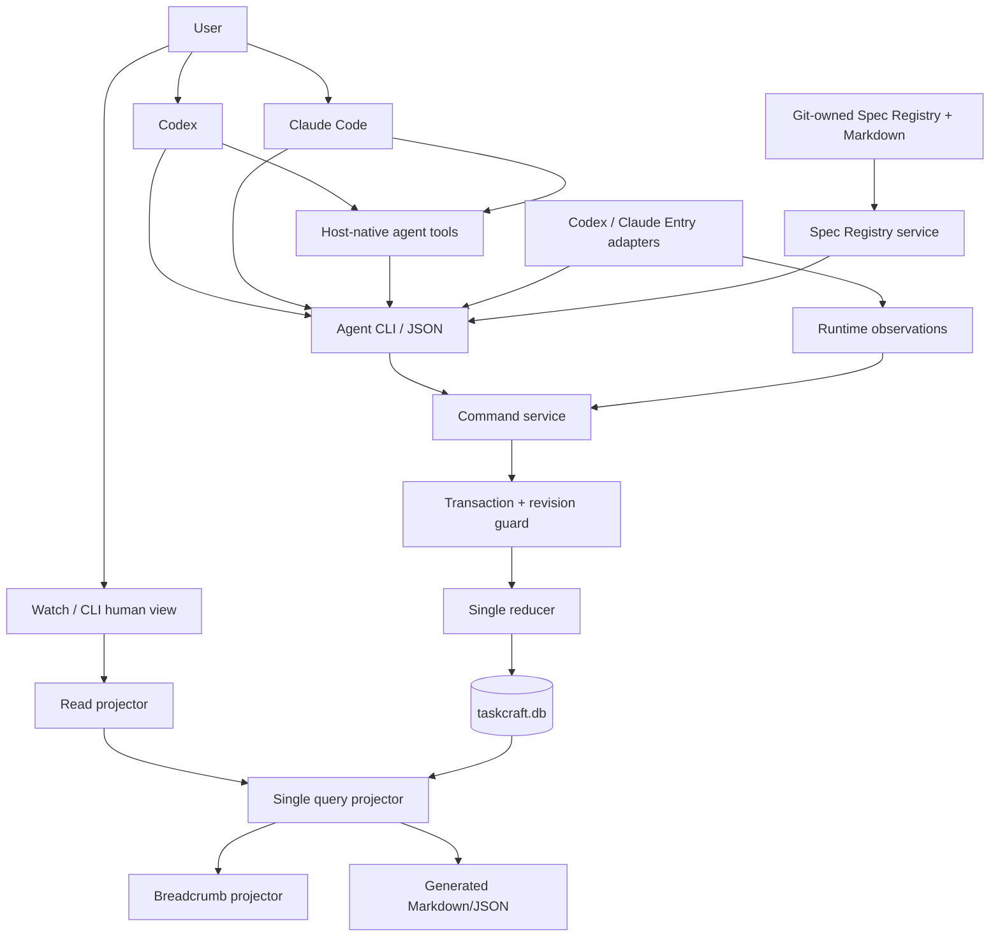
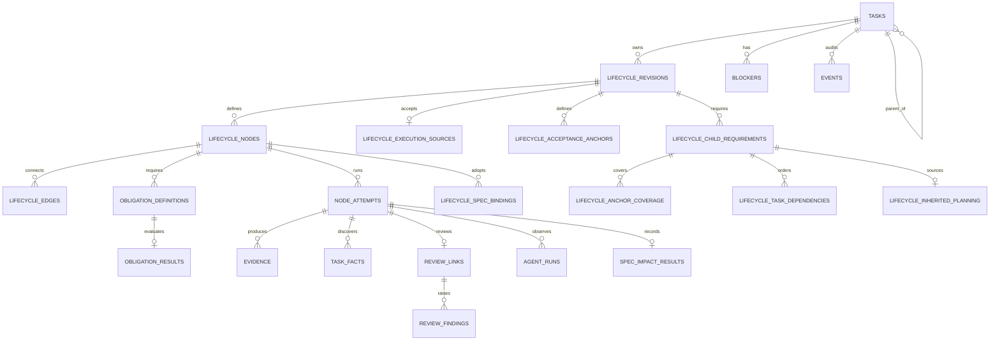

# 架构与唯一真相源

## 1. 架构决策

SQLite 是 Taskcraft 唯一可写的 Task Store，Command service 是唯一写入入口。它承载任务内容、不可变 lifecycle definition、运行事实、Review 关系、证据、阻塞项和审计事件。

任务事实分为三个层次：

1. **Definition facts**：当前任务的 lifecycle revision、节点、边和 obligation definitions。每个 revision 只增不改。
2. **Runtime facts**：任务激活/取消、node attempt、Review link、finding、append-only Task fact、obligation result、evidence、blocker 和 reducer event。
3. **Observations**：宿主运行状态、heartbeat、last seen、token 与耗时，统一存放在 `agent_runs`，用于诊断和提示；只能由 `runAttach` reducer 写入。

`tc watch`、`tc task show`、CLI JSON、Markdown export 和 breadcrumb 都是只读投影。删除这些投影后，Command service 可以从 SQLite 重建相同结果。

项目工程与领域规范是另一类 Git-owned 输入，不是 Task Store 事实。固定入口
`.taskcraft/spec/index.json` 只登记稳定 id、分类、正文路径、摘要、适用路径、状态和
可选 authority；正文仍是仓库内的 Markdown。Registry service 是发现这类输入的
唯一文件系统边界，SQLite 不保存或修改 Registry 与正文。

## 2. 逻辑架构

本节是用户沟通入口、Agent 编排职责、Taskcraft 工具边界与 Adapter 职责的唯一规则源。



Codex 与 Claude Code 是首版用户沟通和任务执行主体，负责使用自身工具完成工作，
并自行决定是否使用 subagent 和并行能力。Taskcraft 只提供任务事实、Node Brief、
可选派发说明、结果校验和记录，不启动或调度 subagent。Command service 负责
canonical facts 与 observations 的写入；Read projector 负责状态、runnable
nodes、下一步和用户视图；Adapter 负责 Entry Hook 安装、节点执行卡渲染、现场
测试与运行观察的纯映射，不直接写 SQLite。Agent 是否继续当前轮次由 Agent 自主
判断，Taskcraft 不通过宿主 Hook 阻止结束。

静态 entry gate 负责一次廉价接管探测：接管关闭或没有 durable execution 时保持静默；检测到可执行任务时注入 task anchor 和下一步命令。该 gate 读取同一个 projector 结果。

## 3. 事实边界

### 3.1 Definition facts

- `lifecycle_revisions` 保存 revision 原因、编译器版本和输入摘要 digest。
- `lifecycle_nodes`、`lifecycle_edges` 保存图结构、typed node kind、objective、procedure reference、scope、gate、retry 和输入输出合同。
- `obligation_definitions` 保存 `required`、`recommended`、`optional` 及其 evaluator 定义。
- `lifecycle_acceptance_anchors`、`lifecycle_execution_sources`、
  `lifecycle_child_requirements`、`lifecycle_anchor_coverage`、
  `lifecycle_task_dependencies`、`lifecycle_validation_assignments` 与
  `lifecycle_inherited_planning` 保存 accepted L3 Plan 编译出的 revision-scoped、
  append-only 定义事实。
- `lifecycle_spec_bindings` 保存 lifecycle revision/node 实际采用的 Spec id、分类、
  路径、duty 和 Frame/Plan/refresh 来源。它不保存 Markdown 正文，也不保存正文哈希：
  绑定记录的是采用了哪些规则文档，不是那些文档当时写了什么。
- stable node id 在跨 revision 的相同语义中复用，新语义使用新 id。

### 3.2 Runtime facts

- `tasks` 保存任务内容、Level 判断事实、激活/取消事实和当前 lifecycle revision 指针。
- `node_attempts` 保存执行事实和 outcome；每个 attempt 永久引用启动时的 lifecycle revision。
- `review_links` 为每个 Review attempt 保存唯一的被审核 attempt、`feasibility|delivery|integration` purpose，以及 `context-only`、`manual-attach`、`host-observed` 能力和独立性披露。
- `task_facts` 保存 Agent 在检查和执行中追加的 intent、probe、constraint、assumption、dependency 与 environment facts；非敏感用户回答和高风险操作决定复用 `constraint` fact。每条 fact 通过来源 attempt 绑定 lifecycle revision，并可引用 evidence；修订通过 `supersedes_fact_id` 追加表达。
- `review_findings` 保存 Review 问题。Review 的 `passed|changes_requested|replan_required` outcome、successor attempt 或新 revision、evidence 与 event 共同表达处理结果，不建立 resolution 表。
- `obligation_results` 记录当前 revision 中每项义务的满足证据；required obligation 满足后才能投影为 `done`。
- `evidence`、`blockers` 和 `events` 保存结果、等待原因和审计链。`blockers.waiting_reason` 是公开 `waitingReason` 的输入事实。
- `spec_impact_results` 为成功的 Record attempt 保存一个不可变的
  `none|updated|candidate` 结果；`updated` 引用当前 Registry snapshot 和本 Task
  evidence，`candidate` 只保存待 owner 决定的提案。
- `spec_sedimentation_results` 为已 `done` 的任务保存一个不可变的沉淀记录：这个
  任务动过哪些 Spec 文档（spec id 列表）与必填 `reason`。行身份是自然键
  `(task_id, lifecycle_revision, 规范化 spec id 列表)`，不含正文指纹、证据引用或
  三态声明，因此同一列表重复提交是 no-op 而不需要派生内容哈希。该表不产生
  obligation，也不参与 `done` 的推导：沉淀是已完成任务的产出，不是它完成合同的
  一步。

### 3.3 Observations

`agent_runs.observation_status` 的枚举为 `pending`、`running`、`stale`、`finished`、`failed`、`unsupported`。`tc run attach` 是 `agent_runs` 的唯一生产写路径，并通过 `runAttach` reducer、CAS、事务和审计事件提交；Adapter 的 `observe` 仅把已存储行映射为宿主观察视图。Projector 将 observation 用于诊断；需要改变任务事实时，Agent 或控制面提交显式 reducer command。

### 3.4 Git-owned Spec 输入

`.taskcraft/spec/index.json` 使用 `tc-spec-registry/v1` 合同。`src/spec/` 接收显式
project directory，以项目 realpath 为边界校验 Registry 和每个正文：绝对路径、
`..`、realpath/symlink 越界、目录、缺失或不可读文件均显式失败。通过校验的正文
通过单一文件描述符读取，打开后复核 realpath/inode；读取前后可观察到的文件替换或
内容变化会显式失败。解析只证明正文存在且可读，**不对字节做哈希**——内容哈希会
绑死文件行尾，让同一份文档在 LF 与 CRLF 检出上得出不同结果。Node 不提供 `openat(2)` 级目录
句柄 API，也不能阻止本机进程原地修改已打开 inode 后伪造回元数据，因此这是一条
可信工作区文件边界，不是对抗同机恶意进程的 sandbox。Registry DTO、
`tc spec list|check|resolve` 和后续命令服务消费者必须复用这一个解析结果，不得各自
读取或解释 Registry。

`appliesTo` glob 只发现 active 候选，不形成 Task binding，也不写
`taskcraft.db`。domain Spec 必须提供明确 authority；代码观察不能自行制造业务真相。

## 4. 数据模型



`src/contracts/storage.sql` 是表结构和外键的唯一合同。Definition 表的 append-only trigger 保持旧 revision、旧 attempt 和旧 evidence 可引用。

## 5. 单 reducer 与纯 projector

所有事实写命令都通过同一 reducer：

```text
reduce(command, taskSnapshot)
  -> validate expectedRevision and references
  -> validate lifecycle contract, outcome rules and result schema
  -> write canonical runtime facts and one audit event
  -> commit in one SQLite transaction

project(taskSnapshot)
  -> derive status, waitingReason, runnable nodes, next command and breadcrumb
```

`tasks` 不保存公开 `status`。CLI、Watch、breadcrumb 和 export 共用同一个 `project()` 结果；查询缓存可以存在，但 reducer 以 canonical facts 重新计算并校验缓存。

### 五个公开状态

| 状态        | Projector 条件                                                      | `waitingReason` |
| ----------- | ------------------------------------------------------------------- | --------------- |
| `queued`    | 任务尚未激活，当前 revision 已登记                                  | 空              |
| `active`    | 任务已激活，至少一个节点 runnable 或 running                        | 空              |
| `done`      | record 结果已满足，当前 revision 的全部 required obligations 已满足 | 空              |
| `cancelled` | 存在显式取消事实                                                    | 空              |

`cancelled` 优先级最高，`done` 需要满足 record 和 required obligations。Attempt 的 `failed` outcome 由 reducer 转为下一次 retry、typed blocker 或取消事实；重试耗尽时使用 `waiting(failed_retries_exhausted)`。

模块化 L3 不引入第六种状态。Projector 只聚合一层 current required children：
任一 child runnable/running 时父任务为 `active`，全部路径阻塞时为 `waiting`，
cancelled child 使父任务进入 `waiting(needs_decision)`，全部 required children
`done` 后父 Integrate 才 runnable。`runnableWorkItems` 返回完整可运行集合；硬阻塞
只来自 child 自身 lifecycle 和显式 dependency edges。

## 6. Level 与 lifecycle 合同

建卡只要求目标、Level 和判级理由。`riskFlags`、`affectedContracts`、
`sideEffects`、`writeScope`、`validationPlan`、`parallelism` 和
`uncertainties` 等事实按需提交；缺失就是未提供。Reducer 据此生成当前 revision
的 required obligations。

Level 表达治理强度判断，当前 revision 的 required obligations 表达可验收合同。Agent 可以通过显式 revision 重新判断 Level 或义务；Projector 以当前 revision 的 required obligations 判断完成。

首版支持 typed node kind：`frame`、`plan`、`execute`、`review`、`integrate`、`record`。
L3 编译为 planning revision 与 accepted execution revision：`modules` 由真实 L1/L2
children gate 父 Integrate，`single` 才在父任务上生成 execute/delivery review。
child 使用 execution-only graph 并保存 inherited planning provenance，不生成伪
Frame/Plan Attempt，也不允许 L3 child 或递归任务树。当前 Agent 按自身能力串行
执行或使用宿主原生 subagent；Taskcraft 只返回 runnable facts 和可选派发说明，
`manual-attach` 只保存已有运行关联。

Lifecycle compiler 根据任务 facts 和 policy digest materialize definition。Review link
保存运行关联能力和独立性披露。局部 Review finding 在当前 revision 为被审核节点
创建同 kind successor attempt；Agent 选择 `replan_required` 时创建单线递增的新
revision。新 revision 生效事务将旧 revision 中 `created` 或 `running` 的 attempt
标记为 `superseded`；旧 attempt 与 evidence 保留原引用，新 revision 引用旧证据
时写入显式 evidence reference。

Spec Impact 通过新 compiler 代际启用：`tc-l1/3`、`tc-l2/3`、`tc-l3/4` 和
`tc-l3-child/3` 的 Record schema 要求 `specImpact`，并带 required
`spec-impact-recorded` obligation。SQLite 中已经保存的旧 compiler revision 继续按
其 exact `output_schema_json` 和原 obligations 完成，不回填 binding 或 Impact。

Spec 沉淀不绑定 compiler 代际：`spec_sedimentation_results`（迁移 0004）与
`tc task spec sediment` 适用于任何已 `done` 的任务，包括旧 compiler revision。
命令边界在追加 Registry 条目之前先完成全部只读校验，reducer 在事务内复用同一校验；
沉淀失败、重放或未写入都不改变 `done`，也不阻止宿主的后续工作。

沉淀记录是历史事实，不做当下校验：doctor 只验证记录本身（reason 非空、spec 列表
非空且唯一、lifecycle revision 存在、不产生 obligation），既不拿今天的 Registry
去比对已写入的记录，也不为历史记录重新校验 spec id 是否仍然存在。

## 7. Revision 与并发

每个 Task 有递增 `revision`，代表事实快照的 CAS 版本；每个 Task 同时维护单线递增的 `current_lifecycle_revision`。写命令携带 `expectedRevision`，不匹配返回 `TC_REVISION_CONFLICT`，响应包含当前 revision 和重读命令。

SQLite 使用 WAL、短写事务和 busy timeout。同一任务的事实写入按 revision 串行化；Agent 可以并行执行不同任务或节点，每次结果写入独立接受 revision/CAS 校验。

## 8. Breadcrumb

```json
{
  "schemaVersion": "tc-breadcrumb/v1",
  "takeover": "active",
  "task": {
    "id": "T-104",
    "level": 2,
    "status": "active",
    "taskRevision": 12,
    "lifecycleRevision": 2,
    "node": "execute-2",
    "nodeKind": "execute",
    "waitingReason": null
  },
  "next": { "command": "tc task next T-104 --json" },
  "detailCommand": "tc task show T-104 --json"
}
```

静默入口只输出必要的 root task anchor；多个 runnable node/children 通过
`tc task next --json` 返回结构化列表。父 L3 与 child 同时 active 时不算多 root
歧义，breadcrumb 锚定父任务，确定性 next 可指向 child。Breadcrumb 的 schema 见
`src/contracts/breadcrumb.schema.json`。

Breadcrumb 负责跨轮定位；节点执行卡负责当前节点指导；command result 负责同轮连续推进。完整行为以 [Agent 连续执行合同](lifecycle.md#7-agent-连续执行合同) 为规则源。

## 9. Adapter contract

```ts
interface HostAdapter {
  capabilities(): AdapterCapabilities;
  installEntry(input: InstallInput): InstallResult;
  testEntryHook(input: HookTestInput): Promise<HookTestResult>;
  renderNodeBrief(input: NodeBriefInput): NodeBrief;
  observe?(run: HostRun): RuntimeObservation;
}
```

数据库中的 host/adapter id 是开放字符串；首版只实现 `codex` 和 `claude` 两个
Adapter，其他值由 Adapter 边界明确返回 unsupported，不建立 Adapter 注册表。
`renderNodeBrief` 生成目标、节点、范围、required obligations、验收、可选派发说明、
本地结果 Schema 和登记命令。Entry Hook 与 Agent 自主推进行为遵循
[Agent 连续执行合同](lifecycle.md#7-agent-连续执行合同)。`context-only` 表示只有
上下文记录，`manual-attach` 表示 Agent 或用户绑定已有 host run，
`host-observed` 表示 Adapter 从宿主事件保存 session/turn/agent correlation。
Review UI 始终展示 capability 和 independence status；`host-observed` 只证明运行
关联，不提供 review 内容签名。

模型只能使用宿主实际暴露给当前会话的工具和上下文。Hook 安装、权限和现场测试
结果由 Adapter 检查并持久化到 `config.entryHookTests`，由 capabilities 与 Watch
Diagnostics 同源展示；Taskcraft 不要求模型猜测宿主的隐藏配置。现场测试要求
恰好一个 active root task，使真实 Entry gate 必须产出 breadcrumb；无 active
root、多 active roots、未注册、未批准、路径损坏或版本漂移都不能伪装成成功。
一个 modular L3 root 与其 active child 共存是正常状态。

`testEntryHook` 是唯一会启动真实宿主进程的 Adapter 方法，因此也是唯一异步的方法：
超时必须终止整棵进程树（Windows 经 `cmd.exe` 启动，只杀直接子进程会留下孤儿宿主），
而按 pid 杀树要求进程仍然存活。`capabilities` 只做有界只读探测，保持同步。

Codex Adapter 将 SessionStart 注册为 `.codex/hooks.json` 中的 matcher group 和
`type: "command"` handler；Claude Adapter 使用 `.claude/settings.json` 的同类三层
结构。Codex 项目 trust 只允许加载项目配置，不等于已信任具体 Hook；Hook 定义变更后
仍需用户在 `/hooks` 中审核。`testEntryHook` 不使用
`--dangerously-bypass-hook-trust`，只有真实宿主输出 breadcrumb 才记录成功。
共享 Entry wrapper 在 breadcrumb 前增加非 JSON 文本标签；裸 JSON stdout 会进入
Codex Hook 控制协议解析，因此不允许直接把业务 breadcrumb 作为 Hook 的完整 stdout。
`tc init --agent` 同时写入两个等价 wrapper：POSIX 注册 `bash .taskcraft/hooks/entry.sh`，
Windows 注册 `node .taskcraft/hooks/entry.mjs`（Windows 宿主经 cmd.exe/PowerShell 执行
hook command，没有 bash）。Node gate 不依赖任何 shell，用 `execFileSync` 调用同一个
公开 CLI，并从自身位置推导项目根，因此与 bash wrapper 行为等价且同样与 cwd 无关。

## 10. 安全与隐私

- DB 保存任务摘要、结构化事件和明确 evidence reference；完整 prompt/tool output 由调用方决定是否外置保存。
- secret 值永远不写 Task Store、event、evidence summary 或日志；Taskcraft 也不
  保存 credential reference。Agent 直接使用宿主已有的凭据能力。
- Watch 绑定 localhost，随机端口服务单次会话。
- Node Brief 遇到付费、外部写入、新凭据或高风险权限时要求 Agent 先询问用户；
  非敏感决定写入 `constraint` fact。Taskcraft 不签发或校验授权凭证。
- export 支持移除绝对路径、session id 和运行细节。
- `doctor` 检查 migration ledger、外键、孤儿事实、事件连续性、definition digest、
  L3 层级/覆盖/依赖/provenance、Spec Registry、binding provenance、Spec Impact
  compiler/obligation/evidence、Spec 沉淀事实、投影重建和 breadcrumb schema；它只读并提供完整性诊断。

## 11. 迁移

从 Kitepath 只读导入任务目标、状态映射、Level、验收、证据摘要、Review finding、父子/来源关系和历史事件。导入器生成逐任务映射报告；旧 `.kitepath` 作为历史来源保留，Taskcraft 从导入完成时接管后续事实写入。
