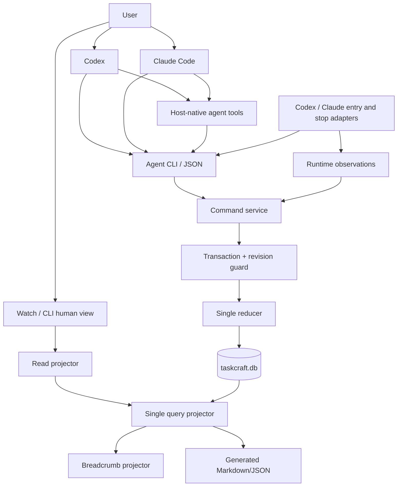
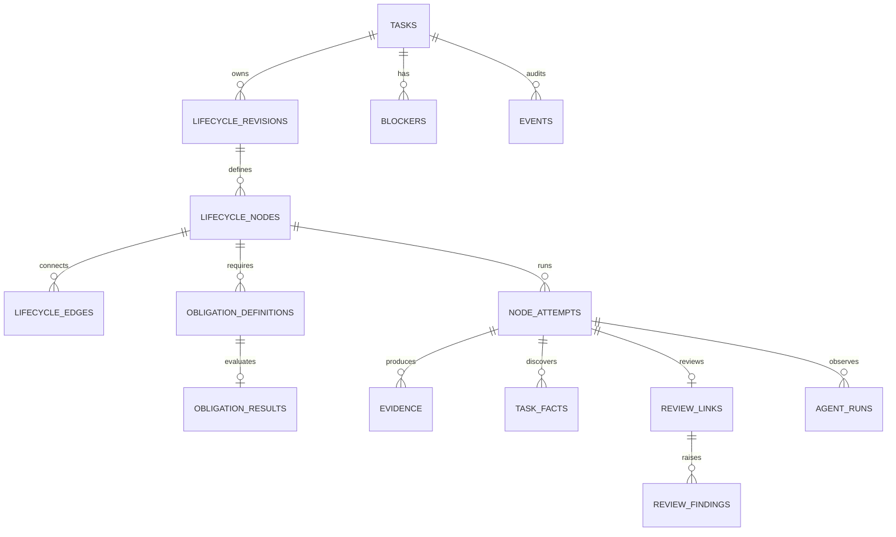

# 架构与唯一真相源

## 1. 架构决策

SQLite 是 Taskcraft 唯一可写的 Task Store，Command service 是唯一写入入口。它承载任务内容、不可变 lifecycle definition、运行事实、Review 关系、证据、阻塞项和审计事件。

任务事实分为三个层次：

1. **Definition facts**：当前任务的 lifecycle revision、节点、边和 obligation definitions。每个 revision 只增不改。
2. **Runtime facts**：任务激活/取消、node attempt、Review link、finding、append-only Task fact、obligation result、evidence、blocker 和 reducer event。
3. **Observations**：宿主运行状态、heartbeat、last seen、token 与耗时，统一存放在 `agent_runs`，用于诊断和提示。

`tc watch`、`tc task show`、CLI JSON、Markdown export 和 breadcrumb 都是只读投影。删除这些投影后，Command service 可以从 SQLite 重建相同结果。

## 2. 逻辑架构

本节是用户沟通入口、Agent 编排职责、Taskcraft 工具边界与 Adapter 职责的唯一规则源。



Codex 与 Claude Code 是首版用户沟通和任务执行主体，负责使用自身工具完成工作，
并自行决定是否使用 subagent 和并行能力。Taskcraft 只提供任务事实、Node Brief、
可选派发说明、结果校验和记录，不启动或调度 subagent。Command service 负责
canonical facts 与 observations 的写入；Read projector 负责状态、runnable
nodes、下一步和用户视图；Adapter 负责入口安装、节点执行卡渲染、正常结束时的
Stop Hook 与可选运行观察。

静态 entry gate 负责一次廉价接管探测：接管关闭或没有 durable execution 时保持静默；检测到可执行任务时注入 task anchor 和下一步命令。该 gate 读取同一个 projector 结果。

## 3. 事实边界

### 3.1 Definition facts

- `lifecycle_revisions` 保存 revision 原因、编译器版本和输入摘要 digest。
- `lifecycle_nodes`、`lifecycle_edges` 保存图结构、typed node kind、objective、procedure reference、scope、gate、retry 和输入输出合同。
- `obligation_definitions` 保存 `required`、`recommended`、`optional` 及其 evaluator 定义。
- stable node id 在跨 revision 的相同语义中复用，新语义使用新 id。

### 3.2 Runtime facts

- `tasks` 保存任务内容、Level 判断事实、激活/取消事实和当前 lifecycle revision 指针。
- `node_attempts` 保存执行事实和 outcome；每个 attempt 永久引用启动时的 lifecycle revision。
- `review_links` 为每个 Review attempt 保存唯一的被审核 attempt、`feasibility|delivery|integration` purpose，以及 `context-only`、`manual-attach`、`host-observed` 能力和独立性披露。
- `task_facts` 保存 Agent 在检查和执行中追加的 intent、probe、constraint、assumption、dependency 与 environment facts；非敏感用户回答和高风险操作决定复用 `constraint` fact。每条 fact 通过来源 attempt 绑定 lifecycle revision，并可引用 evidence；修订通过 `supersedes_fact_id` 追加表达。
- `review_findings` 保存 Review 问题。Review 的 `passed|changes_requested|replan_required` outcome、successor attempt 或新 revision、evidence 与 event 共同表达处理结果，不建立 resolution 表。
- `obligation_results` 记录当前 revision 中每项义务的满足证据；required obligation 满足后才能投影为 `done`。
- `evidence`、`blockers` 和 `events` 保存结果、等待原因和审计链。`blockers.waiting_reason` 是公开 `waitingReason` 的输入事实。

### 3.3 Observations

`agent_runs.observation_status` 的枚举为 `pending`、`running`、`stale`、`finished`、`failed`、`unsupported`。Projector 将 observation 用于诊断；需要改变任务事实时，Agent 或控制面提交显式 reducer command。

## 4. 数据模型



`development/contracts/storage.sql` 是表结构和外键的唯一合同。Definition 表的 append-only trigger 保持旧 revision、旧 attempt 和旧 evidence 可引用。

## 5. 单 reducer 与纯 projector

所有事实写命令都通过同一 reducer：

```text
reduce(command, taskSnapshot)
  -> validate expectedRevision and references
  -> validate lifecycle contract, outcome rules and result schema
  -> write canonical runtime facts and one audit event
  -> commit in one SQLite transaction

project(taskSnapshot)
  -> derive status, waitingReason, runnable nodes, next command and breadcrumb
```

`tasks` 不保存公开 `status`。CLI、Watch、breadcrumb 和 export 共用同一个 `project()` 结果；查询缓存可以存在，但 reducer 以 canonical facts 重新计算并校验缓存。

### 五个公开状态

| 状态 | Projector 条件 | `waitingReason` |
| --- | --- | --- |
| `queued` | 任务尚未激活，当前 revision 已登记 | 空 |
| `active` | 任务已激活，至少一个节点 runnable 或 running | 空 |
| `waiting` | 任务已激活，没有 runnable/running 节点，存在 open blocker | blocker 的 `waiting_reason` |
| `done` | record 结果已满足，当前 revision 的全部 required obligations 已满足 | 空 |
| `cancelled` | 存在显式取消事实 | 空 |

`cancelled` 优先级最高，`done` 需要满足 record 和 required obligations。Attempt 的 `failed` outcome 由 reducer 转为下一次 retry、typed blocker 或取消事实；重试耗尽时使用 `waiting(failed_retries_exhausted)`。

## 6. Level 与 lifecycle 合同

建卡只要求目标、Level 和判级理由。`riskFlags`、`affectedContracts`、
`sideEffects`、`writeScope`、`validationPlan`、`parallelism` 和
`uncertainties` 等事实按需提交；缺失就是未提供。Reducer 据此生成当前 revision
的 required obligations。

Level 表达治理强度判断，当前 revision 的 required obligations 表达可验收合同。Agent 可以通过显式 revision 重新判断 Level 或义务；Projector 以当前 revision 的 required obligations 判断完成。

首版支持 typed node kind：`frame`、`plan`、`execute`、`review`、`integrate`、`record`。L1/L2 纵切优先验证；完整首版提供 `frame -> plan -> feasibility review -> execute -> delivery review -> integrate -> record` 基础 L3 合同。当前 Agent 按自身能力串行执行或使用宿主原生 subagent；Taskcraft 只在 Node Brief 中提供派发说明，`manual-attach` 只保存已有运行关联。

Lifecycle compiler 根据任务 facts 和 policy digest materialize definition。Review link
保存运行关联能力和独立性披露。局部 Review finding 在当前 revision 为被审核节点
创建同 kind successor attempt；Agent 选择 `replan_required` 时创建单线递增的新
revision。新 revision 生效事务将旧 revision 中 `created` 或 `running` 的 attempt
标记为 `superseded`；旧 attempt 与 evidence 保留原引用，新 revision 引用旧证据
时写入显式 evidence reference。

## 7. Revision 与并发

每个 Task 有递增 `revision`，代表事实快照的 CAS 版本；每个 Task 同时维护单线递增的 `current_lifecycle_revision`。写命令携带 `expectedRevision`，不匹配返回 `TC_REVISION_CONFLICT`，响应包含当前 revision 和重读命令。

SQLite 使用 WAL、短写事务和 busy timeout。同一任务的事实写入按 revision 串行化；Agent 可以并行执行不同任务或节点，每次结果写入独立接受 revision/CAS 校验。

## 8. Breadcrumb

```json
{
  "schemaVersion": "tc-breadcrumb/v1",
  "takeover": "active",
  "task": {
    "id": "T-104",
    "level": 2,
    "status": "active",
    "taskRevision": 12,
    "lifecycleRevision": 2,
    "node": "execute-2",
    "nodeKind": "execute",
    "waitingReason": null
  },
  "next": {"command": "tc task next T-104 --json"},
  "detailCommand": "tc task show T-104 --json"
}
```

静默入口只输出必要的 task anchor；多个 runnable node 通过 `tc task next --json` 返回结构化列表。Breadcrumb 的 schema 见 `development/contracts/breadcrumb.schema.json`。

Breadcrumb 负责跨轮定位；节点执行卡负责当前节点指导；command result 负责同轮连续推进。完整行为以 [Agent 连续执行合同](lifecycle.md#7-agent-连续执行合同) 为规则源。

## 9. Adapter contract

```ts
interface HostAdapter {
  capabilities(): AdapterCapabilities;
  installEntry(input: InstallInput): InstallResult;
  testHook(input: HookTestInput): HookTestResult;
  renderNodeBrief(input: NodeBriefInput): NodeBrief;
  attachObservation?(input: AttachInput): HostRun;
  observe?(run: HostRun): RuntimeObservation;
}
```

数据库中的 host/adapter id 是开放字符串；首版只实现 `codex` 和 `claude` 两个
Adapter，其他值由 Adapter 边界明确返回 unsupported，不建立 Adapter 注册表。
`renderNodeBrief` 生成目标、节点、范围、required obligations、验收、可选派发说明、
本地结果 Schema 和登记命令。Entry/Stop Hook 行为遵循
[Agent 连续执行合同](lifecycle.md#7-agent-连续执行合同)。`context-only` 表示只有
上下文记录，`manual-attach` 表示 Agent 或用户绑定已有 host run，
`host-observed` 表示 Adapter 从宿主事件保存 session/turn/agent correlation。
Review UI 始终展示 capability 和 independence status；`host-observed` 只证明运行
关联，不提供 review 内容签名。

模型只能使用宿主实际暴露给当前会话的工具和上下文。Hook 安装、权限和现场测试
结果由 Adapter 检查并写入 Node Brief；Taskcraft 不要求模型猜测宿主的隐藏配置。

## 10. 安全与隐私

- DB 保存任务摘要、结构化事件和明确 evidence reference；完整 prompt/tool output 由调用方决定是否外置保存。
- secret 值永远不写 Task Store、event、evidence summary 或日志；Taskcraft 也不
  保存 credential reference。Agent 直接使用宿主已有的凭据能力。
- Watch 绑定 localhost，随机端口服务单次会话。
- Node Brief 遇到付费、外部写入、新凭据或高风险权限时要求 Agent 先询问用户；
  非敏感决定写入 `constraint` fact。Taskcraft 不签发或校验授权凭证。
- export 支持移除绝对路径、session id 和运行细节。
- `doctor` 检查外键、孤儿事实、事件连续性、definition digest 和投影缓存；它提供完整性诊断。

## 11. 迁移

从 Kitepath 只读导入任务目标、状态映射、Level、验收、证据摘要、Review finding、父子/来源关系和历史事件。导入器生成逐任务映射报告；旧 `.kitepath` 作为历史来源保留，Taskcraft 从导入完成时接管后续事实写入。
