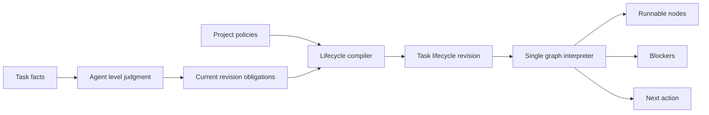
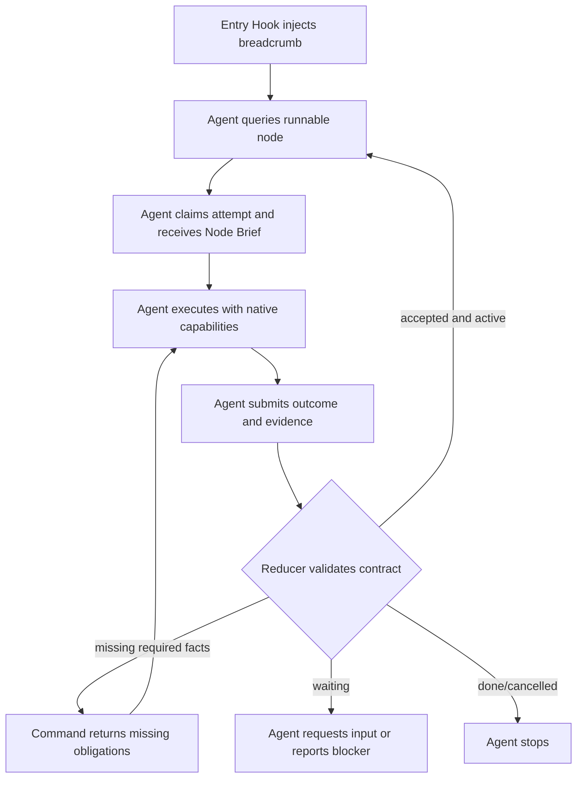
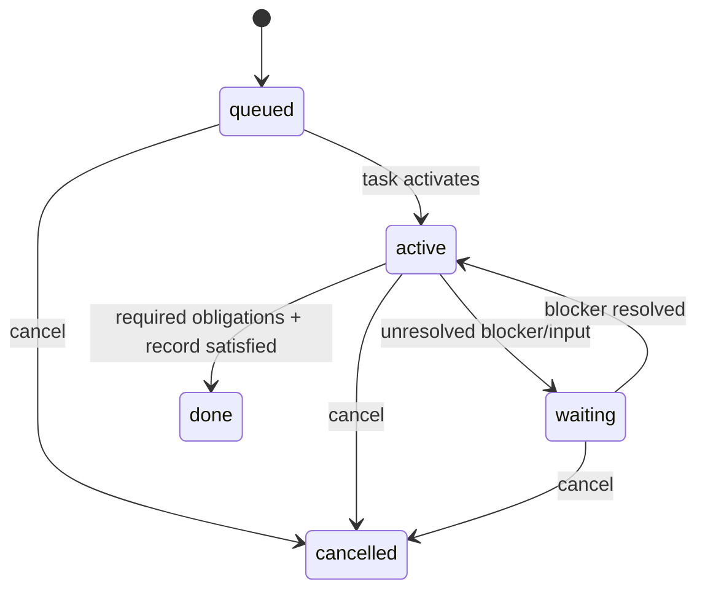
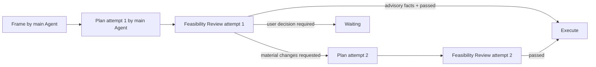
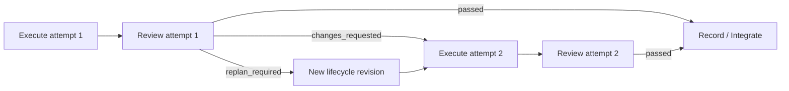

# 任务分级与动态生命周期

## 1. 分级与生命周期

Level 定义最低治理强度与证据预算，任务级节点图定义执行顺序。Agent 根据结构化任务事实判断 Level；Taskcraft 将判定结果和项目 policy 编译为当前任务的 lifecycle revision。revision 中的 required obligations 是该 revision 的执行合同。

## 2. 判级规则

Agent 建卡时只需提交任务目标、Level 和判级理由。`riskFlags`、`affectedContracts`、`sideEffects`、`writeScope`、`validationPlan`、`parallelism` 与 `uncertainties` 等结构化事实按需补充；未提交的字段保持不存在，不写 `unknown` 或占位值。

### L1 Quick

Agent 将以下事实同时成立的任务判为 L1：

- 目标和验收清晰。
- 修改局部、可逆、无外部不可逆副作用。
- 不改变 API、schema、权限、安全、数据完整性或架构边界。
- 当前 Agent 可完成，无共享写入协调。
- 最小自动验证可立即运行。

### L3 Initiative

出现以下任一事实时，Agent 将任务判为 L3：

- 改变跨模块/API/schema/迁移/权限/安全/数据完整性边界。
- 需要多个子任务的依赖与集成。
- 产品方向或验收需访谈、研究或决策。
- 有不可逆外部动作或高影响发布。
- 需要阶段级集成验收。

### L2 Tracked

其余任务进入 L2。Agent 可以 promote；降级通过新 revision 记录原因、差异和新的 required obligations。

任务卡建立后，当前 revision 的 required obligations 是执行合同。Agent 可以在事实变化时 promote 或创建新 revision；合同变更必须留存 reason、old/new diff 和 actor。

## 3. 节点模型

每个 lifecycle node definition 包含：

```text
id, kind, title
objective, procedureRef, scope
inputSchema, outputSchema
obligationDefinitions[]
entryGate, exitGate
retryPolicy
dependencyEdges[]
```

节点表达工作与证据合同。Attempt 记录 actor、运行状态和结果；projector 根据 definition 与 runtime facts 推导节点状态。

### 核心节点

| Node | 何时出现 | 主要输出 |
| --- | --- | --- |
| `frame` | L2/L3 或目标不清 | 目标、范围、验收、非目标 |
| `plan` | L3 或需要拆分/依赖 | 子任务图、依赖、执行约束、集成边界 |
| `execute` | 所有任务 | 工作成果、验证证据、变更摘要 |
| `review` | L2/L3 必做，L1 可选；可审核 plan、execute 或 integrate attempt | pass 或 findings、`reviewed_attempt_id`、review purpose、能力状态 |
| `integrate` | 多交付分支或跨模块结果需要统一验收 | 集成证据与整体验收；manual-attach 接收 plan 的子任务清单与依赖声明 |
| `record` | 所有任务 | 最终结果、残余风险、关闭记录 |

后续 typed node registry 可加入 `research`、`user-input`、`migration-check`、`security-review` 和 `release-check`。

## 4. 义务分级

| Duty | 语义 | 能否阻塞节点完成 | 能否跳过 |
| --- | --- | --- | --- |
| `required` | 完成语义的一部分 | 是 | 否 |
| `recommended` | 默认应做 | 否；项目 policy 可在编译时升级为 required | 可以，按需记录跳过原因 |
| `optional` | 增强质量或效率 | 否 | 可以，按需记录结果 |

未产生 result 的义务投影为 `pending`；持久结果为 `satisfied` 或 `skipped`。`required` 只能写入带有效 evidence 的 `satisfied`，recommended 与 optional 可直接跳过。

## 5. Level 最低合同

### L1

```text
execute [required]
  - requested outcome produced
  - minimum validation recorded
record [required]
  - result and changed scope retained
review [optional]
```

L1 的 `minimum validation recorded` 覆盖最小自检义务。

### L2

```text
frame [required]
execute [required]
review [required, separate attempt]
  - reviewed_attempt_id retained
  - review capability state retained
record [required]
focused plan [recommended when uncertainty exists]
research [optional]
```

### L3

```text
frame [required]
plan [required]
feasibility review [required, separate attempt, reviews plan attempt]
  - user intent coverage retained
  - blocking feasibility assumptions probed
  - decomposition and integration path accepted
execute [required per child]
delivery review [required per execute, separate attempt]
  - reviewed_attempt_id retained
  - review capability state retained
integrate [required when graph has multiple delivery branches]
record [required]
research/security/migration/release checks [recommended or required by policy]
```

## 6. 图编译



编译结果写入 Task Store。Agent 判断局部 finding 时，在同一 revision 创建新的 execute attempt；Agent 判断需要重新规划时，reducer 校验输入结构、CAS、必填 reason 和引用关系后创建新 revision。Agent 负责 scope/contract 语义判断，reducer 负责结构与事务完整性。

首版 lifecycle revision 单线递增、只增不改。每个 revision 记录 compiler version、facts digest、policy digest、typed reason 和 old/new diff。跨 revision 保持相同语义的节点复用稳定 node id，新语义使用新 id；稳定 node id 表达 lineage。

revision 切换事务将旧 revision 中 `created` 或 `running` 的 attempt 标记为 `superseded`。旧 revision 的节点停止接受新 attempt，历史 attempt 与 evidence 保留；新 revision 通过稳定 node id 和显式 evidence 引用使用历史事实。

## 7. Agent 连续执行合同

本节是节点执行卡、连续推进、Entry Hook 与 Stop Hook 协作方式的唯一规则源。

### 7.1 节点执行卡

节点执行卡（Node Brief）是当前 lifecycle definition 与 runtime facts 的只读投影。Agent 每次领取节点 attempt 时获得一张节点执行卡，其中必须包含：

- Task、task revision、lifecycle revision、node id 与 node kind。
- 当前节点的目标、适用 procedure 和期望输出。
- 已满足的输入、可读取证据、执行范围和依赖。
- `required`、`recommended`、`optional` obligations 及其当前结果。
- 允许提交的 typed outcomes、验收条件与结果登记命令。
- 当前宿主、已知工具能力和可选派发说明。Agent 有 subagent 工具时可以派发，
  没有时由当前 Agent 自己执行；Taskcraft 不启动 subagent。
- 本地结果 Schema。Agent 按该格式提交，Taskcraft 在写入前校验；宿主或模型的
  原生结构化输出能力只是可选辅助。
- 需要用户决定的高风险动作，以及不得写入 Task Store 的 secret 边界。

Projector 使用节点 definition、当前任务 facts、已有 attempt/evidence 和 procedure registry 生成节点执行卡。Procedure registry 为 `frame`、`plan`、`execute`、`review`、`integrate` 与 `record` 提供通用执行方法；当前节点 definition 的 `objective`、`procedureRef`、`scope`、输入输出合同与 obligations 提供任务特定内容。Lifecycle compiler 只 materialize 能解析 `procedureRef` 的 typed node。

Breadcrumb 保持为紧凑定位投影，携带当前 Task、lifecycle revision、节点、状态和下一条查询命令。节点执行卡承载 Agent 完成当前节点所需的执行内容。

### 7.2 连续推进



每个成功的事实写命令必须返回提交后的 task status、waiting reason、完成节点和唯一 next。正常执行时，Task 为 `active` 且存在 runnable/running node，Agent 继续完成“领取节点执行卡、执行、提交结果”的循环。Taskcraft 只提供 next 和 Node Brief，不替 Agent 执行节点。

Agent 在以下投影条件下结束当前连续运行：

- `done`：当前 revision 的 required obligations 与 record 已满足。
- `cancelled`：任务存在显式取消事实。
- `waiting`：用户输入、用户决定、外部依赖或失败重试决策尚未满足。
- 宿主返回明确的资源或能力限制；Agent 将限制登记为 observation 或 typed blocker。

用户可以随时中断当前运行。中断不等于任务失败或取消，已有事实保持不变；下次
会话从 Task Store 投影出的 next 恢复。

### 7.3 Hook 协作

Entry Hook 在任务首次进入、会话恢复或上下文重建时注入 breadcrumb。节点之间的正常推进由 CLI command result 中的 next 完成。

Stop Hook 只在 Agent 自己准备正常结束当前运行时读取最新 breadcrumb：

- `active` 且存在 runnable/running node：返回当前节点和 next，阻止这次正常结束并恢复连续循环。
- `waiting`、`done` 或 `cancelled`：允许当前运行结束。

用户主动中断始终放行，不受 Stop Hook 限制。首版只支持已验证具备 Entry/Stop
Hook 的 Codex 和 Claude；Hook 缺失或失效时明确报错并进入 diagnostics，不在
首版内提供无 Hook 降级流程。

## 8. 状态与闭环

### Task status

`tc task new` 只创建 Task、初始 lifecycle revision 和 required obligations，公开
状态为 `queued`，不创建 attempt。`tc run <task-id>` 是唯一激活入口；第一次运行
在同一 reducer 事务中写入激活事实并创建或领取首个 runnable node attempt。
已激活任务上的后续 `run` 只处理目标 node attempt，不重复激活。

```text
queued | active | waiting | done | cancelled
```

- `queued`：任务已登记，尚未激活。
- `active`：至少一个节点 running 或存在可运行节点。
- `waiting`：没有可运行节点，且存在 typed blocker。`waiting_reason` 取 `needs_input`、`needs_decision`、`failed_retries_exhausted` 或 `blocked_dependency`。
- `done`：所有 required 义务满足，record 已完成。
- `cancelled`：用户或策略显式终止，保留原因。

### Node status

```text
pending | running | waiting | satisfied | skipped
```

### Review outcome

```text
passed | changes_requested | replan_required
```

Review outcome 归属于 attempt；projector 根据当前 revision 的全部事实独立推导 task status。

Attempt 失败记录 retryable 或 terminal outcome；宿主 stale 保留在 observation。重试预算耗尽时，reducer 写入 `failed_retries_exhausted` blocker，projector 输出 `waiting`；下一步由 Agent 选择 retry、replan 或 cancel。



## 9. Review 回流

本节是 Review purpose、被审核 attempt、finding 回流与 L3 Feasibility Review 的唯一规则源。

### 9.1 L3 Feasibility Review

L3 在 Plan 与 Execute 之间生成 required Feasibility Review。Review 使用独立节点和
attempt。独立 reviewer 可用时优先使用；不可用时当前 Agent 可以完成 Review，
并如实记录 `same-actor`。Adapter 保存 `context-only`、`manual-attach` 或
`host-observed` 关联能力；界面显示 `observed-distinct`、`unverified`、
`same-actor` 或 `unsupported`。独立性是披露信息，不是 Execute 的硬性 gate。



Feasibility Reviewer 的 required obligations 固定为：

- 建立“用户意图 -> Plan 子任务 -> 验收动作”的覆盖关系。
- 探测会改变方案、任务拆分或验收的外部 API、SDK、CLI、权限、环境与依赖假设。
- 检查子任务边界、依赖顺序、写入冲突、验证责任和最终集成路径。
- 将探测结果追加为 Task fact 与 evidence，并标明来源、时间和结论。

Feasibility Reviewer 使用宿主已有工具完成必要检查，Taskcraft 不提供 probe
runner。需要副作用、付费、新凭据或高风险权限的检查先创建
`waiting(needs_decision|needs_input)` 并询问用户。非敏感回答写为当前 revision
来源 attempt 的 `task_facts`；secret 不进入 Task Store、event 或 evidence。

Feasibility Review 在以下条件同时成立时通过：

- 每项用户意图都有对应子任务或验收动作。
- 没有已知的阻断性可行性问题。
- 子任务、关键依赖、验证责任和集成路径可以执行。

局部实现方式、低影响未知项和优化建议记录为 advisory finding，不阻止通过。`changes_requested` 只用于未覆盖用户意图、阻断性假设、不可执行的拆分/依赖或缺失的验证/集成路径。

Feasibility Reviewer 可以追加 `intent`、`probe`、`constraint`、`assumption`、`dependency` 与 `environment` Task facts 及其 evidence。主 Agent 负责修改目标、范围、验收和 Plan attempt。初次 Review 后默认进行一次集中 Plan 修订；第二次仍存在 blocking finding 时，主 Agent 必须选择再次修订、记录并接受风险，或进入 `waiting(needs_decision)`。

所有 Execute 节点都依赖当前 Plan attempt 的 Feasibility Review `passed` outcome。Projector 在该 gate 满足前不投影 Execute 为 runnable。

### 9.2 Delivery Review 与回流



Review 只使用三个 outcome：

- `passed`：当前 Review 完成，按 lifecycle edge 进入下一节点。Reviewer 在 Review
  过程中修改过内容时，把变更、diff 和验证作为 evidence 记录，结果仍是 `passed`。
- `changes_requested`：在当前 revision 为被审核 node kind 创建 successor attempt，
  修复后重新 Review。
- `replan_required`：finding 改变目标、范围、接口、Schema、验收或 lifecycle
  graph，Reducer 创建新 lifecycle revision；L3 的新 Plan 再次经过 Feasibility
  Review。

共同约束：

- Review 使用独立节点和独立 attempt，并记录 `reviewed_attempt_id` 与 `reviewPurpose`。`feasibility` 审核 plan attempt，`delivery` 审核 execute attempt，`integration` 审核 integrate attempt。Adapter 声明 `context-only`、`manual-attach` 或 `host-observed` 能力；UI 始终展示 `observed-distinct`、`unverified`、`same-actor` 或 `unsupported` 独立性状态。
- finding 归属原 Task，不创建另一种 Review Task。
- 不创建 `review_resolutions`；outcome、successor/revision 引用、finding、evidence
  和 event 已足以说明处理结果。所有路径保留旧产物和证据。
- `changes_requested` 在当前 revision 为被审核 node kind 创建 successor attempt；`replan_required` 在 scope、contract 或 lifecycle graph 改变时创建 lifecycle revision。
- Integrate 只执行组合验证时可以进入 Record；Integrate 修改代码、配置或冲突结果时必须生成 `integration` Review。

## 10. Agent 编排与并行

执行主体与工具边界遵循 [架构与唯一真相源](architecture.md#2-逻辑架构)。Taskcraft projector 返回可运行节点、依赖事实和可选派发说明；reducer 负责 CAS、引用、节点归属和结果合同校验。是否使用宿主原生 subagent 由当前 Agent 决定；没有该能力时当前 Agent 自己执行。Taskcraft 不创建派发实体，也不启动或调度 subagent；`manual-attach` 只记录已有运行关联。

Agent 仅在写入范围不冲突、共享验证 owner 明确、依赖已满足且并行收益明确时并行执行。Reducer 在依赖、CAS 或节点归属冲突时写入 typed blocker，并返回稳定 remediation。

## 11. 图安全约束

- 每个 revision 至少一个终点 `record`。
- 禁止没有 Review/用户输入等可观察条件的无界循环。
- 节点数和边数由实现版本设定可解释上限，并在超限时返回稳定错误。
- required obligation 必须可追溯到某个节点输出或 evidence evaluator。
- lifecycle revision 只增不改；旧节点与其 attempt/evidence 保持可追溯，当前视图的隐藏不会物理删除历史事实。
- 后续动态插件的扩展边界是 typed node、gate 与 obligation；Task 顶层状态固定为五种。
