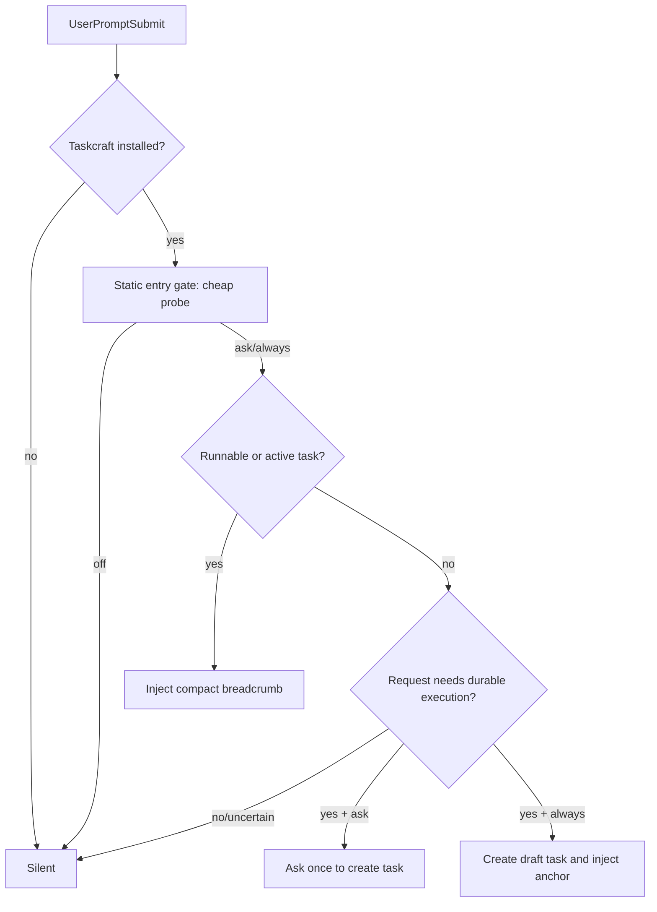

# 产品定义与交互

## 1. 产品定位

Taskcraft 是运行在代码仓库内、主要供 Agent 调用的任务协议与状态工具。Codex 与 Claude Code 是用户沟通入口；Taskcraft 为它们提供任务判级、任务事实、动态生命周期、节点执行卡、Review 能力披露、进度投影与可恢复记录。执行归属以 [架构与唯一真相源](architecture.md#2-逻辑架构) 为规则源。

Taskcraft 聚焦仓库内的 Agent 任务执行。用户的主要动作是开启接管、查看进度、补充输入、处理异常和确认高风险决策。

## 2. 目标用户与主使用者

### 主使用者：Agent

Agent 需要：

- 在每轮上下文中快速知道当前任务、当前节点、阻塞和唯一下一步。
- 用结构化 CLI 原子推进任务，不手改状态文件。
- 只在需要时加载目标、验收、scope、evidence 与 node procedure。
- 能把 execute 与 review 放在不同节点和 attempt，并查看 Review 宿主关联能力与独立性状态。
- 在失败、失联或上下文压缩后恢复，不猜测先前状态。
- 用户发起任务后持续领取并完成节点，直到任务完成、取消或确实需要输入。

### 观察者：用户

用户需要：

- 看见 Agent 正在做什么、为什么、完成到哪里。
- 看见目标、范围、验收、当前节点、证据和 Review 结论。
- 在需要输入、用户决定、变更范围或 Agent 失联时收到清晰提示。
- 不需要理解 reducer、schema、workflow slot 或 runtime manifest。

## 3. 产品原则

1. Agent 接口短，用户视图丰富，两者来自同一查询投影。
2. 默认沉默；显式状态比持续提醒更重要。
3. 正确路径必须少于手工绕过路径。
4. Command service 是任务事实的唯一写入口。
5. 每个阻塞都说明缺什么、由谁补、补完执行什么。
6. 动态性由任务级节点图、typed outcome 和 obligation 表达。
7. Review 是独立节点和 attempt 关系，`reviewed_attempt_id` 与能力状态都向用户公开。

## 4. 用户旅程

### 4.1 初始化

```bash
tc init --agent codex
tc agent test-hook
tc enable ask
```

`init` 创建 `.taskcraft/config.json`、`.taskcraft/taskcraft.db`、极薄 entry block 和宿主 hook。

### 4.2 普通问答

用户提问且无需持久执行时，hook 零输出，Agent 按普通能力回答，Task Store 保持不变。

### 4.3 L1 小任务

用户要求清晰、局部、可逆的修改。Agent 先创建公开状态为 `queued` 的 L1 卡，
再用 `tc run` 激活任务并领取 execute attempt，运行最小验证，最后完成 record。
L1 的最低合同由 `execute -> record` 构成。

### 4.4 L2 跟踪任务

Agent 明确目标/范围/验收，执行后进入独立的 review 节点和 attempt。Review 记录
`reviewed_attempt_id`、宿主关联能力（`context-only`、`manual-attach`、
`host-observed`）和独立性状态。有独立 reviewer 就使用；没有时当前 Agent 自审并
披露 `same-actor`。Reviewer 对局部问题直接修复时记录 diff 和验证 evidence，
outcome 仍为 `passed`；实质实现问题使用 `changes_requested` 创建新 execute
attempt；合同变化使用 `replan_required` 创建新 lifecycle revision。

### 4.5 L3 复杂任务

`frame` 和 `plan` 由当前 Agent 完成。Feasibility Review 使用独立节点和 attempt，
检查关键外部假设、用户意图覆盖、拆分、依赖、验证和集成路径；独立 reviewer
不可用时允许当前 Agent 自审并披露 `same-actor`。通过后 Execute 才可运行。
Node Brief 可以给出派发说明，是否使用宿主原生 subagent 由当前 Agent 决定；
Taskcraft 不派发 subagent，只记录已有运行关系。

### 4.6 连续执行

用户发起一次任务后，Agent 按 [Agent 连续执行合同](lifecycle.md#7-agent-连续执行合同) 依次领取节点执行卡、提交结果并执行下一节点。Taskcraft 只在 `waiting` 需要输入、用户决定、外部依赖或失败处理时请求用户介入。用户随时可以中断；下次会话从已保存的 next 恢复。

### 4.7 Agent 失联

运行状态变为 stale 时，任务状态继续由 reducer 根据当前节点、blocker 和 attempt 事实投影；Agent 或用户可以 attach、retry、重新规划或取消。旧 attempt 的结束原因保留，重试耗尽写入 `waiting(failed_retries_exhausted)`。

## 5. 信息架构

### Watch Board

显示：任务标题、Level、公开状态、当前节点、required 完成度、blocker、宿主、最后活动、下一动作。

默认按 `Active / Waiting / Queued / Done / Cancelled` 分组。Review 状态通过节点图、attempt outcome 和能力标签表达。

### Task Detail

显示：

- 目标、范围、非目标、验收。
- Level 与判级理由。
- 当前 lifecycle revision 与节点图。
- 每个节点的 required/recommended/optional 义务。
- evidence、Review finding、Agent attempt、事件时间线。
- Feasibility Review 追加的探测事实、证据、意图覆盖与未决假设。
- 下一条 CLI 命令。

### Runtime

显示 host、run id、node、attempt、last seen、finish reason，以及 Entry/Stop Hook
最近一次现场测试结果和失败原因。Runtime observation 与任务事实使用独立视觉层级。

### Diagnostics

只在异常时展示：hook 丢失、adapter 版本漂移、DB migration、revision conflict、required evidence missing、host unsupported。

## 6. 静默入口



静态 entry block 在上下文已有 `<tc-state>` 时直接使用该 breadcrumb；其余情况运行 `tc state --breadcrumb`。该命令执行一次轻量探测：落盘修改、多步执行、委派、等待外部输入或需要后续恢复时返回 task anchor，接管关闭、普通问答和不确定请求返回空输出。

## 7. 视图状态

原型和未来实现必须覆盖：

- 未初始化、off、ask、always。
- 无任务、queued、active、waiting、done、cancelled。
- L1/L2/L3。
- execute、review、integrate 与 record 当前节点。
- required 缺失、recommended 未做、optional skipped。
- Review pass、changes requested、需要重新 plan。
- Reviewer 修改内容后的 diff/evidence、同 kind successor 与新 lifecycle revision。
- L3 Feasibility Review 的探测中、待修改、通过与等待决策。
- Agent running、stale、attempt failed、finished but result not collected，以及 `waiting_reason`。
- Entry/Stop Hook 的可用与失败诊断状态。
- revision conflict、DB migration failure、hook timeout、host unsupported。

## 8. 首版边界

- Web 提供只读任务视图，任务操作调用 Command service。
- Task Store 保存任务摘要、结构化事实和 evidence reference。
- Agent heartbeat 进入 runtime observation，完成状态由当前 revision 的 required obligations 与 record 结果推导。
- L1 任务使用 `execute -> record`；L2 使用 `frame -> execute -> delivery review -> record`；L3 的基础合同包含 `frame -> plan -> feasibility review -> execute -> delivery review -> integrate -> record`，节点顺序由当前 revision 决定。
- 首版部署边界是单仓库、单机、本地用户；团队账号、云同步和远程权限属于后续版本。
